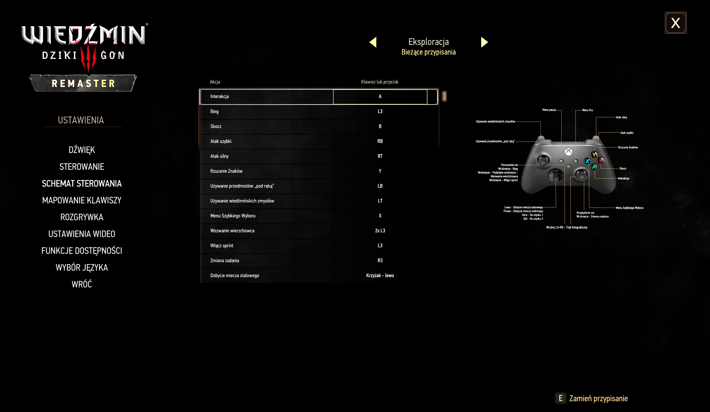
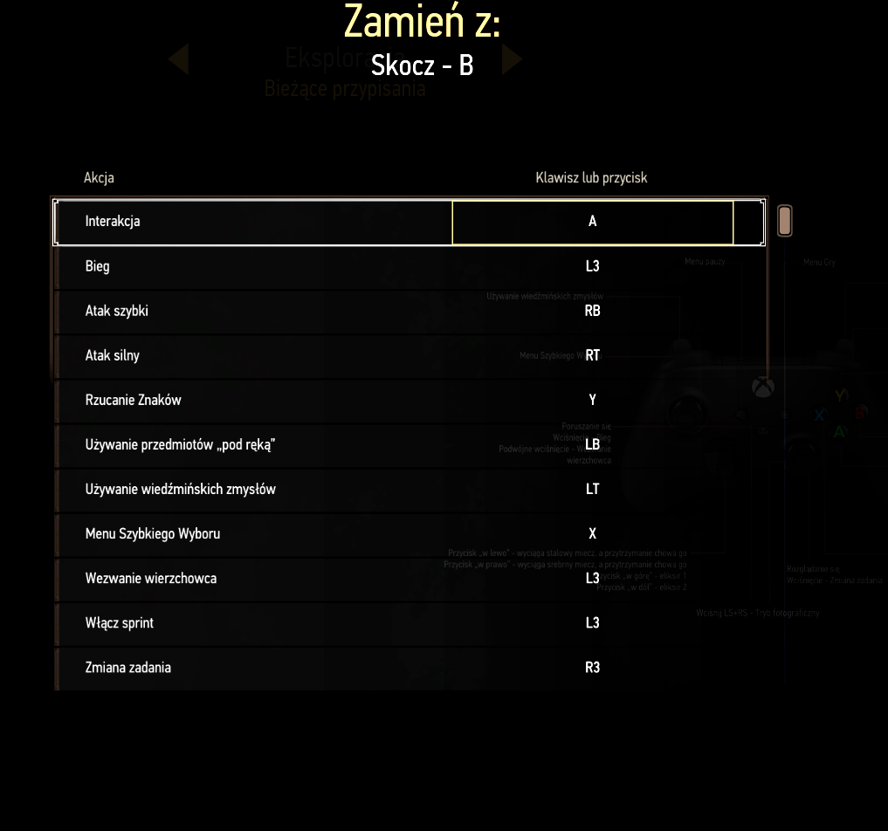

# Witcher3ModsControlMapping

Witcher3ModsControlMapping is an unofficial fan-made mod that replaces the read-only "Gamepad layouts" screen of The Witcher 3 (**Settings → Controls scheme**) with a table of your current gamepad bindings per context (Exploration, Swimming, Combat, Horse, Boat). Press A (E on keyboard) on a row, then pick another row to swap the two buttons in that context only; the game saves the change to `input.settings` itself.

## Features

### Gamepad bindings table

See every gamepad binding at a glance. The read-only "Gamepad layouts" screen is replaced with a table that lists the button assigned to each action, grouped by context: Exploration, Swimming, Combat, Horse and Boat.

### Swap two buttons

Remap controls in a few clicks. Press A (E on keyboard) on a row, then pick another row, and the two buttons are swapped. The swap applies only to the context you are viewing (Exploration, Swimming, Combat, Horse or Boat); the other contexts keep their own bindings, so swapping two buttons for Combat does not change them for Exploration. The pad picture next to the table shows the bindings of the selected context. The game saves the change to `input.settings` on its own, so no manual file editing is needed.

## Download

Each release has two ZIPs with the same mod:

- **Automatic**: includes `install.cmd` and `uninstall.cmd`. The easy way on Windows.
- **Manual**: no script files at all (nothing for an antivirus or a file host to flag). You extract it into the game folder yourself, see [below](#install-or-update-by-hand).

## Install automatically (Windows)

1. Close the game. Download the **Automatic** ZIP from the **Releases** page and extract it anywhere.
2. In the extracted `mods\modWitcher3ModsControlMapping` folder, double-click **`install.cmd`**. It finds your Witcher 3 folder (Steam, GOG, Epic or the usual folders on every drive; it asks for the path if needed), replaces any previous version of the mod in `mods` and puts the config XML into `bin\config`.

To remove the mod, double-click **`uninstall.cmd`** (in the extracted folder or in `mods\modWitcher3ModsControlMapping`). It removes the mod folder, its config XML and the mod's own entries in the `*user.settings` files in `Documents\The Witcher 3` (a copy of each edited file is kept) and nothing else. The button swaps you made are stored by the game in `input.settings`, so before removing anything it asks whether to reset **all** your controls to the game defaults: if you answer yes, `input.settings` is moved aside (a copy is kept next to it) and the game creates a fresh one on the next start; if you answer no, it is not touched.

Both files are plain text, so you can open them in Notepad and read exactly what they do. Windows SmartScreen may warn about a downloaded script: choose **More info, Run anyway** if you trust it, or use the Manual package.

## Install or update by hand

Requires the PC next-gen version of The Witcher 3. Back up your saves and mod installation before updating.

1. Close the game and open its folder, the one that contains `mods` and `bin`. On Steam: right-click the game → **Manage → Browse local files**.
2. For an update, first move the previous `modWitcher3ModsControlMapping` folder **outside `mods`**.
3. Extract the **Manual** ZIP into that folder, merging it with the existing `mods` and `bin`. It places the mod in `mods\modWitcher3ModsControlMapping` (its `.ws` files end up in `content\scripts\local\`) and the config XML in `bin\config\r4game\user_config_matrix\pc\witcher3modscontrolmapping.xml`. The engine reads the XML only from there and ignores it inside the mod folder; without it swapping is rejected.
4. Start the game, allow script compilation and load your save.

Instead of a ZIP you can copy this repository's `src/modWitcher3ModsControlMapping` folder into `mods` (it also holds the installers' sources, which the game ignores) and then move the `bin` folder from inside it out to the game folder, next to `mods`.

To uninstall by hand, close the game and move the mod folder outside `mods`, then delete the XML from `bin\config\r4game\user_config_matrix\pc\`. Keep backups outside those folders too.

If something went wrong and the mod does not work, close the game and delete `C:\Users\<your name>\Documents\The Witcher 3\input.settings`; the game will create it again with the defaults.

## License

Original project material uses the [Personal Noncommercial Use License](LICENSE): source inspection, local builds and modifications for private, noncommercial use with a lawful copy of The Witcher 3. Redistribution requires separate permission, except for rights preserved in LICENSE (including earlier grants and CDPR/platform rights). This is source-available, not MIT or OSI open source; third-party licenses remain separate.

CDPR supplies Flash UI sources for modding in the [REDkit FAQ](https://www.thewitcher.com/us/en/redkit/modding). Use of this mod is limited to noncommercial play within The Witcher 3, subject to the [REDkit EULA](https://store.steampowered.com/eula/2889630_eula_0), [Fan Content Guidelines](https://www.cdprojektred.com/en/fan-content) and applicable game terms. These do not make third-party middleware freely redistributable as a standalone SDK. See [THIRD-PARTY-NOTICES.txt](THIRD-PARTY-NOTICES.txt); both notices and LICENSE accompany the installable mod.

This is an unofficial fan work and is not approved or endorsed by CD PROJEKT RED. Provided **as is, without warranty**, subject to LICENSE and applicable law.
